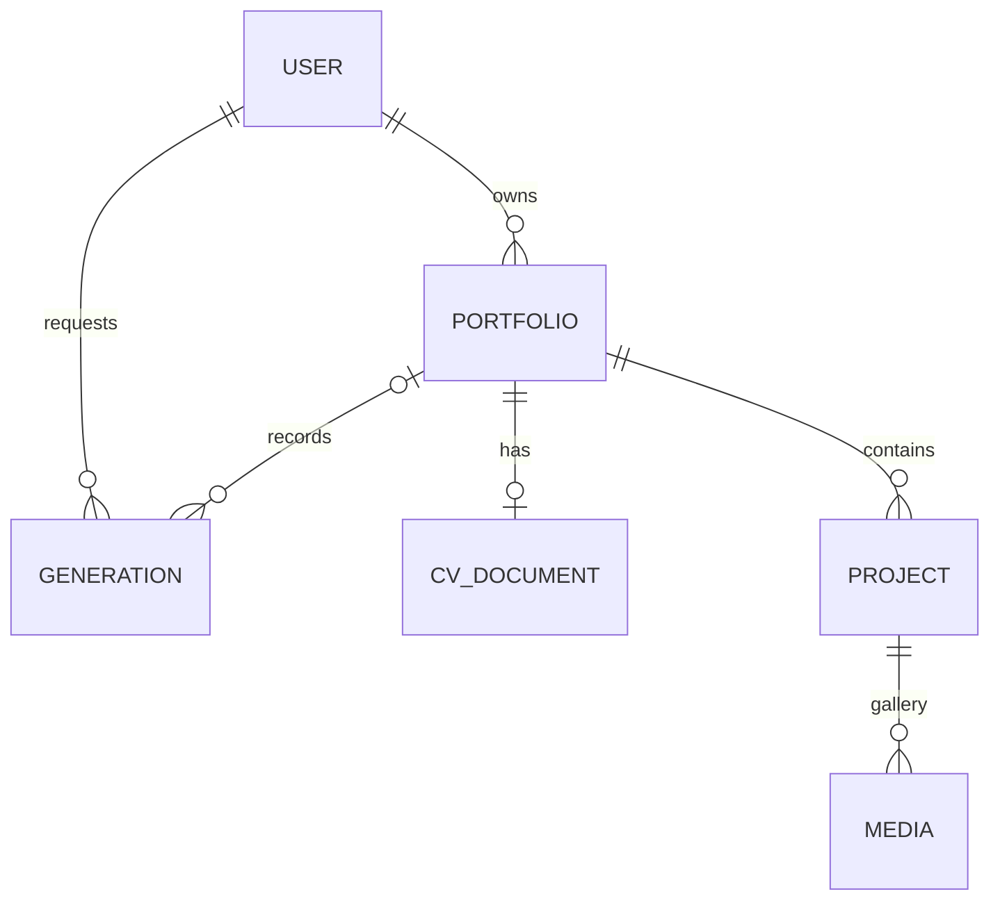

# Portmyfolio — Data Model

Status: agreed architecture, 23 November 2026. Implements [VISION.md](VISION.md); delivery stages are in [PLAN.md](PLAN.md).

Five application-owned models plus Spatie’s Media model. Use relational records for ownership, projects, uploaded files, and generation. Use validated JSON for nested page content and the current published snapshot. Framework infrastructure tables for sessions, cache, and queues are separate from this model list.

## Relationships



A user's optional default_portfolio_id points to one of their published portfolios. Add this foreign key after creating portfolios to resolve the migration dependency. All models have primary IDs and created_at/updated_at timestamps. Store application dates in UTC.

## User

| Field | Shape / constraint |
| --- | --- |
| google_id | Unique stable Google account identifier; not an OAuth access token |
| email | Google-provided email; not the identity key |
| name | Account display name |
| username | Unique normalized public username; may be null until onboarding completes |
| default_portfolio_id | Nullable portfolio foreign key, set null on portfolio deletion |

No production password login. Portfolio display names remain independent of the account name. Default selection must enforce ownership and publication. Do not retain Google access/refresh tokens unless a concrete feature needs them.

## Portfolio

| Field | Shape / constraint |
| --- | --- |
| user_id | Owner foreign key |
| title | Dashboard title |
| slug | Normalized public slug; unique with user_id |
| focus | Target audience / job context |
| preset | Validated preset identifier |
| accent_color | Valid hex color, without contrast restrictions |
| home_content | Validated JSON |
| cv_content | Validated JSON |
| published_snapshot | Nullable validated JSON; sole source of public page content |
| published_at | Nullable timestamp of the current publication |

Working fields and related projects represent the draft. Publish validates and copies the complete draft into a snapshot atomically. Publishing again replaces that snapshot; no revision-history model or rollback UI. Unpublish clears the snapshot and published_at, plus the user's default pointer if applicable.

The snapshot includes schema_version, publication time, preset/accent, home content, CV content/download permission, original PDF reference, ordered projects, and ordered image references. Public pages must not substitute draft project content or draft image metadata into this snapshot. URL resolution uses the current user and portfolio records; project lookup uses the snapshot's project slugs.

## CvDocument

| Field | Shape / constraint |
| --- | --- |
| portfolio_id | Unique foreign key; at most one source PDF per portfolio |
| storage_path | Private file path on the configured CV disk |
| original_filename | Owner-facing filename |
| mime_type, size_bytes | Validated file metadata |
| status | uploaded / processing / ready / failed |
| extracted_content | Nullable validated JSON of extracted facts |
| error_code | Nullable safe failure identifier |

The extraction record is evidence. Portfolio.cv_content is editable presentation. Editing one never mutates the other. Download permission is part of the published CV content, not a public bucket setting. Serve approved downloads through a route that checks publication and the published permission.

## Project

| Field | Shape / constraint |
| --- | --- |
| portfolio_id | Portfolio foreign key |
| slug | Unique with portfolio_id |
| repository_owner, repository_name | Normalized GitHub identity; pair unique within portfolio |
| author_role | Required user-supplied role; editable |
| readme_content | Nullable collected evidence before fetching finishes |
| readme_fetched_at | Nullable evidence timestamp |
| title, summary, overview | Editable content; may be empty during input collection |
| technologies | Validated JSON string array |
| live_url | Nullable validated HTTP(S) URL |
| position | Integer ordering key |
| deleted_at | Nullable soft-delete timestamp, preserving published media until cleanup |

No is_featured: show every project on the homepage in position order, using id as a deterministic tie-breaker. Repository URLs are derived from normalized identity. Projects in separate portfolios remain separate records, even when they describe the same repository. No shared Repository or Technology model is needed in the MVP. README fetch caching uses normalized repository identity.

Maximum five projects is enforced transactionally in application actions; it is not a simple row-level database constraint. Post-generation project addition remains a product decision and must not accidentally expose another AI-generation flow.

## Media (Spatie Media Library)

Use Spatie's standard `media` table and model instead of a parallel ProjectImage table. Projects will implement HasMedia and use InteractsWithMedia, with a `gallery` collection. CvDocument remains our separate private PDF/extraction model.

| Media field | Purpose |
| --- | --- |
| model_type, model_id | Polymorphic association with the owning Project |
| collection_name | `gallery` |
| disk, conversions_disk, file_name | Storage location managed by Spatie |
| mime_type, size | File metadata |
| order_column | Gallery ordering; first active image is the cover |
| custom_properties.caption, custom_properties.alt_text | Editable presentation metadata |
| custom_properties.draft_removed | Tombstone excluding an image from the draft without deleting published files |
| custom_properties.width, custom_properties.height | Dimensions recorded during upload processing |

No separate ProjectImage model/table. Reordering uses explicit controls rather than drag-and-drop. Freeze caption, alt text, order, and immutable file references in the published snapshot, rather than reading mutable Media properties for public rendering.

Removing an image from a draft marks it removed; it must not call Media::delete(), clearMediaCollection(), or another file-deleting operation while a published snapshot references the image. Physically delete only after neither draft nor published content needs the file. Never overwrite existing objects when replacing an image.

Spatie automatically cleans up media when a HasMedia owner is deleted. Therefore draft project removal must retain the owner while its published representation exists (a soft-delete/tombstone strategy will be implemented with Project in Stage 2). Publication cleanup may force-delete that owner only after the old snapshot is replaced and its media is no longer referenced. Portfolio deletion first removes public access, then deletes projects/media through the coordinated deletion action. The exact cleanup job/transaction boundaries are implemented and tested in Stages 3–4, before public galleries ship.

## Generation

| Field | Shape / constraint |
| --- | --- |
| user_id | Requesting user foreign key |
| portfolio_id | Nullable foreign key, set null on portfolio deletion |
| status | queued / running / succeeded / failed |
| current_step | Safe dashboard stage identifier |
| progress | Validated JSON of checkpoints and per-project completion |
| input_snapshot | Frozen validated inputs, including required role and portfolio focus |
| provider, model, prompt_version | Generation configuration |
| usage | JSON usage totals; per-step detail where available |
| error_code | Nullable safe failure identifier |
| started_at, completed_at | Nullable execution timestamps |

One generation is the initial pipeline, not one provider request. Automatic retries continue that record and reuse completed steps. Successful generation cannot be restarted. A failed initial attempt may be resumed/retried under a defined recovery policy, without regenerating an already completed portfolio.

Quota reservation locks the user row in a transaction. Count all queued/running reservations plus successes completed in the previous seven days; permit a new attempt only below three. Success starts the seven-day usage window; permanent failure releases the reservation. Portfolio deletion preserves the quota record. Recovery of abandoned queued/running records needs bounded timeouts so reservations cannot remain stuck indefinitely.

Deleting a portfolio during active processing must cancel/terminalize its work before detaching it. Jobs check that the target still exists and is eligible before writing. Retained quota records must not indefinitely retain deleted CV content, focus, or README evidence: redact input/progress payloads on deletion while preserving quota timestamps/status/owner.

## Initial JSON contracts

Persist schema versions and validate nested keys and limits. All rendered text is escaped; arbitrary model-supplied HTML is not accepted.

```text
home_content
  schema_version
  name, headline, introduction
  contact: email?, location?, links[{id, label, url}]

cv_content
  schema_version
  name, headline, summary
  contact: email?, location?, links[{id, label, url}]
  experience[{id, organization, role, start_date?, end_date?, description}]
  education[{id, institution, qualification, start_date?, end_date?, description}]
  skills[string]
  languages[{id, name, proficiency?}]
  allow_original_download: boolean
```

Stable entry IDs support editing/reordering. Store month-level CV dates as validated YYYY-MM values, not invented exact days. Nullable end dates can represent ongoing entries; the UI must distinguish unknown from ongoing when needed. Final required fields, text limits, and date semantics are settled before building the CV forms. No per-employer, per-skill, or per-education tables are needed because these entries are edited/rendered as a document, not queried across users.

## Application boundaries

- Form requests validate inputs; policies enforce ownership, including nested resource ownership.
- StartPortfolioGeneration validates eligibility, reserves quota, freezes inputs, and dispatches durable work.
- PublishPortfolio validates complete content and atomically captures a consistent snapshot; coordinate with draft mutations to avoid mixed versions.
- UnpublishPortfolio and SetDefaultPortfolio maintain the default-selection invariant.
- DeletePortfolio coordinates active jobs, quota preservation, published references, and file cleanup.
- Complete initial generation atomically exposes its assembled draft; disallow conflicting edits while initial generation is active.
- Use database constraints for foreign keys/uniqueness and application transactions for cross-record invariants. Add indexes for portfolio ordering and quota lookups.
- Keep deterministic local demo fixtures and factories for all application-owned models, with Spatie media fixtures; do not require external providers to seed the database.

## Deferred decisions

Exact field lengths, file limits, missing-README rules, partial-failure recovery, post-generation project addition, slug-change behavior, and retention policy are resolved in the corresponding PLAN.md stage. This document does not add regeneration, featured projects, or a public admin interface.
