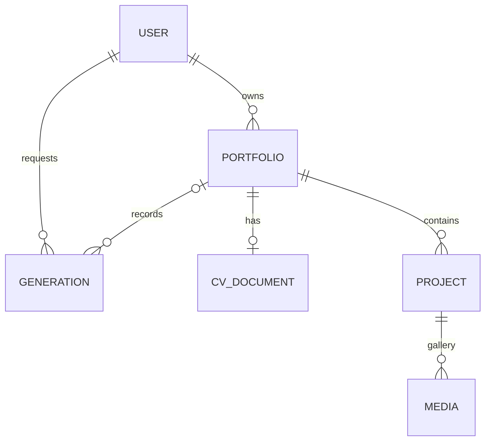

# Portmyfolio — Data Model

Status: agreed architecture, 23 November 2026. Implements [VISION.md](VISION.md); delivery stages are in [PLAN.md](PLAN.md).

Five application-owned models plus Spatie’s Media model. Use relational records for ownership, projects, uploaded files, and generation. Use validated JSON for nested page content and the current published snapshot. Framework infrastructure tables for sessions, cache, and queues are separate from this model list.

## Relationships



A user's optional default_portfolio_id points to one of their published portfolios. Add this foreign key after creating portfolios to resolve the migration dependency. All models have primary IDs and created_at/updated_at timestamps. Store application dates in UTC.

## User

| Field | Shape / constraint |
| --- | --- |
| google_id | Unique stable Google account identifier; not an OAuth access token |
| email | Google-provided email; not the identity key |
| name | Account display name |
| username | Unique normalized public username; may be null until onboarding completes |
| default_portfolio_id | Nullable portfolio foreign key, set null on portfolio deletion |

No production password login. Portfolio display names remain independent of the account name. Default selection must enforce ownership and publication. Do not retain Google access/refresh tokens unless a concrete feature needs them.

## Portfolio

| Field | Shape / constraint |
| --- | --- |
| user_id | Owner foreign key |
| title | Dashboard title; generated from account identity in the primary demo flow |
| slug | Automatically generated stable public slug in the primary flow; unique with user_id |
| focus | Target audience / job context |
| preset | Validated preset identifier |
| accent_color | Valid hex color, without contrast restrictions |
| home_content | Validated JSON |
| cv_content | Validated JSON |
| published_snapshot | Nullable validated JSON; sole source of public page content |
| published_at | Nullable timestamp of the current publication |

Working fields and related projects represent the draft. Publish validates and copies the complete draft into a snapshot atomically. Publishing again replaces that snapshot; no revision-history model or rollback UI. Unpublish clears the snapshot and published_at, plus the user's default pointer if applicable.

The snapshot includes schema_version, publication time, preset/accent, home content, CV content, immutable original PDF reference, ordered projects, and ordered image references. Public pages must not substitute draft project content or draft image metadata into this snapshot. URL resolution uses the current user and portfolio records; project lookup uses the snapshot's project slugs.

## CvDocument

| Field | Shape / constraint |
| --- | --- |
| portfolio_id | Unique foreign key; at most one source PDF per portfolio |
| storage_disk, storage_path | Private disk and immutable file path; older rows without a stored disk fall back to configured CV disk |
| original_filename | Owner-facing filename |
| mime_type, size_bytes | Validated file metadata |
| status | uploaded / processing / ready / failed |
| extracted_content | Nullable validated JSON of extracted facts |
| error_code | Nullable safe failure identifier |

The extraction record is evidence. Portfolio.cv_content is editable presentation. Editing one never mutates the other. Every published portfolio exposes its original PDF through a route that checks the current snapshot; unpublishing disables new downloads. Buckets stay private. The former optional-download flag is superseded.

## Project

| Field | Shape / constraint |
| --- | --- |
| portfolio_id | Portfolio foreign key |
| slug | Unique with portfolio_id |
| repository_owner, repository_name | Normalized GitHub identity; pair unique within portfolio |
| author_role | Required user-supplied role; editable |
| readme_content | Nullable collected evidence before fetching finishes |
| readme_fetched_at | Nullable evidence timestamp |
| title, summary, overview | Editable content; may be empty during input collection |
| technical_details | Required new generation output; editable text up to 10,000 characters; empty compatibility default for older rows |
| technologies | Validated JSON string array |
| live_url | Nullable validated HTTP(S) URL |
| position | Integer ordering key |
| deleted_at | Nullable soft-delete timestamp, preserving published media until cleanup |

No is_featured: show every project on the homepage in position order, using id as a deterministic tie-breaker. Repository URLs are derived from normalized identity. Projects in separate portfolios remain separate records, even when they describe the same repository. No shared Repository or Technology model is needed in the MVP. README fetch caching uses normalized repository identity.

Maximum five projects is enforced transactionally in application actions; it is not a simple row-level database constraint. Manual post-generation repository-backed additions are allowed, without any AI call. Repository identity and slug remain fixed on an existing project. A removed repository can be restored as a manual draft project; generation evidence is never rewritten.

## Media (Spatie Media Library)

Use Spatie's standard `media` table and model instead of a parallel ProjectImage table. Projects implement HasMedia and use InteractsWithMedia, with a `gallery` collection. CvDocument remains our separate private PDF/extraction model.

| Media field | Purpose |
| --- | --- |
| model_type, model_id | Polymorphic association with the owning Project |
| collection_name | `gallery` |
| disk, conversions_disk, file_name | Storage location managed by Spatie |
| mime_type, size | File metadata |
| order_column | Gallery ordering; first active image is the cover |
| custom_properties.caption, custom_properties.alt_text | Editable presentation metadata |
| custom_properties.draft_removed | Tombstone excluding an image from the draft without deleting published files |
| custom_properties.width, custom_properties.height | Dimensions recorded during upload processing |

No separate ProjectImage model/table. Reordering uses explicit controls rather than drag-and-drop. Freeze caption, alt text, order, and immutable file references in the published snapshot, rather than reading mutable Media properties for public rendering.

Removing an image from a draft marks it removed; it must not call Media::delete(), clearMediaCollection(), or another file-deleting operation while a published snapshot references the image. Physically delete only after neither draft nor published content needs the file. Never overwrite existing objects when replacing an image.

Spatie automatically cleans up media when a HasMedia owner is deleted. Therefore draft project removal must retain the owner while its published representation exists (a soft-delete/tombstone strategy will be implemented with Project in Stage 2). Publication cleanup may force-delete that owner only after the old snapshot is replaced and its media is no longer referenced. Portfolio deletion first removes public access, then deletes projects/media through the coordinated deletion action. The exact cleanup job/transaction boundaries are implemented and tested in Stages 3–4, before public galleries ship.

## Generation

| Field | Shape / constraint |
| --- | --- |
| user_id | Requesting user foreign key |
| portfolio_id | Nullable foreign key, set null on portfolio deletion |
| status | queued / running / succeeded / failed |
| current_step | Safe dashboard stage identifier |
| progress | Validated JSON of checkpoints and per-project completion |
| input_snapshot | Frozen validated inputs, including required role and portfolio focus |
| provider, model, prompt_version | Generation configuration |
| usage | JSON usage totals; per-step detail where available |
| error_code | Nullable safe failure identifier |
| started_at, completed_at | Nullable execution timestamps |

One generation is the initial pipeline, not one provider request. Automatic retries continue that record and reuse completed steps. Successful generation cannot be restarted. A failed initial attempt may be resumed/retried under a defined recovery policy, without regenerating an already completed portfolio.

Generation start locks the user and portfolio rows to reject duplicate starts and coordinate draft writes/deletion. There is no account quota or slot reservation. Retain generation status/timestamps and provider usage for processing/debugging. Recovery still terminalizes abandoned work with bounded attempts and deadlines.

Deleting a portfolio during active processing must cancel/terminalize its work before detaching it. Jobs check that the target still exists and is eligible before writing. Retained generation records must not indefinitely retain deleted CV content, focus, or README evidence: redact input/progress payloads on deletion while preserving processing timestamps/status/owner.

## Initial JSON contracts

Persist schema versions and validate nested keys and limits. All rendered text is escaped; arbitrary model-supplied HTML is not accepted.

```text
home_content
  schema_version
  name, headline, introduction

cv_content
  schema_version
  name, headline, summary
  contact: email?, phone?, location?, links[{id, label, url}]
  experience[{id, organization, role, location?, start_date?, end_date?, current, description}]
  education[{id, institution, qualification, location?, start_date?, end_date?, current, description}]
  skills[{id, name, items[string]}]
  languages[{id, name, proficiency?}]
  certifications[{id, name, issuer?, date?, url?}]
```

Stable entry IDs support editing/reordering. Dates accept YYYY or YYYY-MM, with no invented day/month. The current boolean explicitly distinguishes ongoing entries from unknown end dates; current entries have no end date. End-date bounds account for year-only precision. No per-employer, per-skill, or per-education tables are needed because these entries are edited/rendered as a document, not queried across users.

## Application boundaries

- Form requests validate inputs; policies enforce ownership, including nested resource ownership.
- StartPortfolioGeneration validates eligibility, freezes inputs, and dispatches durable work.
- PublishPortfolio validates complete content and atomically captures a consistent snapshot; coordinate with draft mutations to avoid mixed versions.
- UnpublishPortfolio and SetDefaultPortfolio maintain the default-selection invariant.
- DeletePortfolio coordinates active jobs, history redaction, published references, and file cleanup.
- Complete initial generation atomically exposes its assembled draft; disallow conflicting edits while initial generation is active.
- Use database constraints for foreign keys/uniqueness and application transactions for cross-record invariants. Add indexes for portfolio ordering and generation status lookups.
- Keep deterministic local demo fixtures and factories for all application-owned models, with Spatie media fixtures; do not require external providers to seed the database.

## Deferred decisions

Stage 3 settles editor field lengths, gallery/file limits, and manual project addition below. Missing-README rules, partial-failure recovery, and evidence retention remain assigned to their corresponding PLAN.md stages. This document does not add regeneration, featured projects, or a public admin interface.


## Stage 2 implementation limits

Usernames are immutable after onboarding, normalized to lowercase, 3–30 characters, start with a letter, and use letters/digits separated by single hyphens; application-reserved names are rejected. Portfolio titles allow 120 characters, slugs 64, and optional focus text 5,000. Slugs are unique per owner. Creation accepts only title/slug/focus; ownership and publication fields cannot be supplied by the form.

Historical Stage 2 behavior: deletion accepted only unpublished portfolios without queued/running generations. Stage 4 now supports published deletion; active-generation deletion remains blocked until Stage 6. It removes database access transactionally, preserves generation usage rows with their source/progress payloads redacted, and dispatches retryable file cleanup after commit. Full publication-aware removal remains a later-stage requirement. Historical Stage 2 fixtures served model/dashboard demonstrations; fresh Stage 4 fixtures also support public pages.


## Stage 3 content and file contracts

Name and headline are required (120 characters each) when saving page content; both home/CV JSON copies are updated atomically. Home is otherwise just introduction (optional, 3,000); CV summary is independent (optional, 5,000). Contact detail appears on CV only. Contact email allows 254 characters, phone 40, location 120, and up to ten labeled HTTP(S) links (label 80, URL 2,048). Each experience/education section allows 30 entries; required organization/role or institution/qualification fields allow 160, location 120, description 5,000. Skills allow 30 named groups with 40 skills each (80 characters per skill). Languages and certifications allow 30 entries each. These nested arrays reject undeclared keys and retain stable entry IDs in submitted order.

Project title is required (120), role required (255), summary optional (1,000), overview optional (10,000), technologies up to 30 strings (80 each), live URL optional HTTP(S) (2,048). Source README and other input evidence cannot be overwritten through editor payloads. Five active projects maximum under the owner/portfolio lock. No manual editor endpoint publishes or generates content.

Source CV is one immutable private PDF up to ten MB, with MIME/signature/completeness checks (not content extraction or malware scanning). Replacing it is prohibited, including after successful generation. Existing source rows remain compatible with the new nullable storage_disk field. Source evidence and editable web CV remain independent. Stage 3 stored a draft download preference; Stage 4 supersedes it with mandatory source-PDF download while published. Owner routes remain private.

Gallery inputs are still JPEG/PNG/WebP, ten MB maximum, 12,000 pixels per side and 24 megapixels total; ten active images per project. GD decodes/reorients/resizes to fit 2,400 pixels and encodes WebP at quality 85 without metadata. Only that processed file is persisted under an immutable UUID filename. Captions/alt text allow 500 characters. custom_properties.decorative=true implies empty alt_text; otherwise a description is required. Use private images_local or images_s3 storage, never a public bucket. Owner previews deliver files via authorized non-cacheable routes.

Draft image deletion sets draft_removed; project deletion soft-deletes its owner. Stage 3 cleanup retained all media while a snapshot existed. Stage 4 supersedes that behavior with reference-aware cleanup across draft and publication, plus controlled public delivery. Row locks serialize cap checks and ordering; draft mutations reject queued/running generation. File operations account for failures independently of database rollback, with retryable cleanup jobs.


## Stage 4 publication invariants — 25 November 2026

All canonical slugs are immutable. Publishing locks owner/portfolio consistently with draft edits, checks successful initial generation and a stored source PDF plus at least one active repository-backed project, validates structural/safety constraints, and freezes the complete saved draft. Optional content may be empty. Public rendering must read text, ordering, appearance, captions, and file references solely from this snapshot; never fall back to current draft rows. Snapshot references identify the source disk/path and immutable media disk/paths.

If the owner has no default, publication assigns this portfolio atomically. Publishing a second portfolio preserves the existing default; Make default is available in its editor and tile. Unpublish/delete clears a matching default without selecting a substitute. /username resolves only an owned currently published default. Missing addresses reveal no private data.

The original PDF is downloadable whenever published: no permission toggle or separate revocation action. New CV content and snapshots omit allow_original_download; any legacy value is ignored. Publish confirmation explains both portfolio and original-PDF exposure. Unpublish disables new public page/media/PDF requests. Already downloaded files cannot be recalled.

Publication cleanup runs after commit and checks current draft and snapshot references again under a lock. It may remove tombstoned media or force-delete a soft-deleted project only after neither version references them. Initial-generation eligibility is enforced server-side; local fixtures simulate success without exposing a production bypass. No shared public cache is introduced, avoiding stale published content/download access after unpublish.


## Stage 5 collection and provider boundary — 25 November 2026

Focus is optional (5,000 characters). Creation validates and collects one immutable PDF (10 MB, 1–20 pages) and 1–5 normalized public repositories/roles together. Project title/summary/overview start empty; README evidence and fetched_at are stored separately. No Generation record exists until Stage 6 starts the durable pipeline. No AI request is made during collection.

Full READMEs must contain more than 200 meaningful characters and fewer than 100,000 bytes. Public evidence caches for one hour; saved project evidence lasts with the portfolio. Portfolio deletion cascades CV/project evidence deletion, redacts generation input/progress and queues file cleanup. Shared public README caches expire after one hour. Provider results carry validated content, provider/model/prompt version and usage. Stage 6 will persist extraction/checkpoints and atomically assemble editable content; Stage 5 exposes no paid extraction web endpoint or regeneration action.


## Stage 6 decisions agreed — 25 November 2026

Explicit Generate freezes source PDF, focus, normalized repositories/roles and evidence. Conflicting edits are blocked while active. Each technical step gets at most three automatic attempts; honor rate-limit times and retain completed checkpoints. User retry resumes the same failed initial attempt with unchanged inputs, rechecks/reserves quota, and never regenerates a successful portfolio. Changed inputs require a new portfolio.

Independent project checkpoints remain private until all work can be assembled atomically. Three successful generations in rolling seven days, plus active reservations, exhaust quota. Permanent failure releases a reservation; deleting success never refunds it. Processing leases fence duplicate/late workers, with scheduled recovery of stale work. Active deletion terminalizes work before detaching/redacting source payloads; late responses are discarded. Already-sent requests may incur costs.

Progress is saved and polled: Checking inputs, Reading CV, Writing projects (completed/total), Assembling portfolio, Ready. Scanned fictional-CV quality verification remains pending before end-to-end acceptance. Stage 6 implementation proceeds on codex/stage-6-generation; no merge/deployment is implied.


Stage 6 implementation adds run_version, lease_token, lease_expires_at and next_run_at to Generation. Queue payloads contain only generation ID/run version; source content remains in private database snapshots. progress.done and progress.checkpoints track validated extraction/project/profile completion; attempts counts technical calls per step per run. usage stores per-step provider/model/prompt/usage metadata. Terminal deletion clears source/progress and all lease/schedule fields, increments run_version and marks active work failed/cancelled while preserving succeeded usage history. Frozen failed-attempt inputs are protected from editor mutations; retries reuse the same record and checkpoints. Assembly writes CV extraction evidence plus home/CV/project presentation atomically under owner/portfolio/generation locks.


## Stage 6.1 demo-flow revision — 25 November 2026

The primary demo journey is now PDF/repository inputs → private portfolio filling from generation checkpoints → ready draft, with inline pencil editing reserved for Stage 6.2. Title/address are generated automatically; optional focus is secondary. Existing backend authorization, quota, frozen inputs, retries and publication isolation remain. The two agreed camomilesson demo repositories retain their previously supplied Solo developer context; unknown repositories have no assumed personal contribution.

Technical details is a required field on newly generated projects, separate from the functionality overview and technology tags. The existing per-project call returns technical_details grounded in the full README; no additional provider call. Persist the field and include it in publication snapshots and editor validation. Older portfolios/snapshots remain readable with an empty compatibility value; existing generated portfolios cannot regenerate to populate it.

During generation, owner-only previews derive a transient presentation from completed extraction, project and profile checkpoints. Pending sections show explicit placeholders rather than fabricated content. Reload/revisit reconstructs the presentation; terminal failure retains completed sections and offers retry in place. Final draft assembly remains atomic. Public requests never read checkpoints and existing publication snapshots remain unchanged until Publish changes. The current separate editor remains supporting navigation until Stage 6.2 replaces it.


## Quota removal — 25 November 2026

No rolling-window queries, reserved slots or account exemptions remain. Earlier quota-specific descriptions are historical. Generation rows/usage and deletion redaction remain useful processing history and require no schema change.
